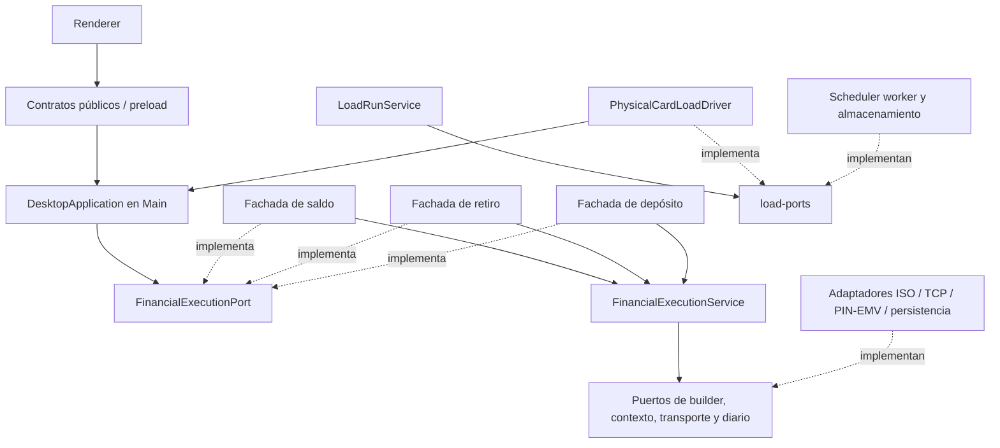

# Arquitectura implementada

Estado de referencia: 2026-11-03. Las decisiones históricas y sus sustituciones
se consultan en el [índice ADR](docs/adr/README.md). Este documento describe los
componentes actuales; la arquitectura objetivo distribuida sigue siendo una propuesta.

## Capas y responsabilidades

| Capa | Ubicación | Responsabilidad |
| --- | --- | --- |
| Dominio | `packages/domain/src` | Validación, contratos transaccionales y métricas; sin Node, Electron ni adaptadores |
| Contratos públicos | `packages/shared/src` | API tipada del puente IPC y mensajes entre procesos; sin secretos |
| UI | `apps/desktop/src/renderer` | Formularios y resultados; consume el puente de preload |
| Preload | `apps/desktop/src/preload.ts` | API mínima bajo context isolation |
| Aplicación | `apps/desktop/src/main/application.ts` | Valida contexto, ambiente y revisiones; coordina exclusión financiera |
| Motor financiero | `financial-execution-service.ts` en Main | Idempotencia, contexto, diario previo al envío, transporte, cierre y limpieza |
| Carga | `load-run-service.ts`, `physical-card-load-driver.ts` | Coordina corrida, tarjeta, ritmo, cancelación, métricas y resultados |
| Evidencia de carga | `load-history-service.ts`, `load-export-service.ts` | Consulta paginada y exportación mediante puertos separados del control de ejecución |
| Configuraciones de carga | `load-configuration-service.ts`, `load-configuration-ports.ts` | Biblioteca QA validada, con adaptador SQLite y auditoría independiente de las corridas |
| Adaptadores e infraestructura | Subdirectorios de Main | ISO/framing, TCP, PC/SC, cifrado TEST, SQL, SQLite y workers |

## Dependencias

Las fachadas de saldo, retiro y depósito inyectan su builder y configuración al mismo motor.
Retiro no hereda del servicio de saldo. Los DTO de mensaje pertenecen a contratos
internos de Main y los adaptadores los consumen. El driver de carga depende de
interfaces de lector, operaciones financieras y ciclo de vida de sesiones; no
lee el PIN. Ver [ADR-032](docs/adr/ADR-032-FINANCIAL-EXECUTION-PORTS.md).

Lint y las pruebas de `architecture-boundaries.test.ts` protegen dominio,
contratos públicos, Renderer y motores frente a imports indebidos, incluyendo
imports de tipos, reexports e imports dinámicos.

## Ejecución y persistencia

Main deriva el destino desde configuración y vuelve a validar el ATM y la
seguridad antes de transmitir. El motor registra PENDING antes del envío y
conserva `runId`, `transactionId`, `requestId`, STAN/RRN cuando existen. La misma
solicitud no se retransmite tras reinicio. Los diarios serializan sus escrituras
para conservar respuestas fuera de orden.

Los diarios financieros y de carga usan SQLite; las importaciones desde JSON
conservan el original como respaldo. Una corrida activa recuperada se marca
interrumpida y no se reanuda. Un resultado incierto conserva esa clasificación.
La conexión SQLite de carga y sus consultas de historial se ejecutan en un worker
dedicado detrás de los mismos puertos. El esquema 2 agrega índices de consulta;
un timeout del worker no provoca reenvío de escrituras. Ver [ADR-039](docs/adr/ADR-039-LOAD-STORAGE-WORKER.md).
Los errores históricos de retiro terminados y guardados permiten una nueva
solicitud explícita; pendientes, reversos activos y fallos de persistencia mantienen
su bloqueo. Ver [ADR-025](docs/adr/ADR-025-QA-WITHDRAWAL-AFTER-ERROR.md).

## Concurrencia y recursos

- **Enlace QA:** una conexión financiera activa. La cola de QaSwitchConnection
  espera turno, respeta cancelación y plazo, y cierra antes de liberar el enlace.
- **Saldo en carga:** 1–5 operaciones en preparación/envío; chip exclusivo y
  posibilidad de preparar mientras el host responde.
- **Retiro:** una operación activa, también en carga. Operaciones manuales
  conservan exclusión respecto de la corrida.
- **Ritmo:** límite global antes de cada escritura, sin créditos acumulados.
  El objetivo de TPS no garantiza el caudal observado.
- **Sesiones:** PC/SC y cifrado reutilizan procesos durante la corrida, con
  lectura y seguridad nuevas por operación. PIN de sesión solo en Main y borrado
  al cerrar. No se cachean tramas ni claves descifradas.
- **Observación:** la conexión de observación se libera antes del transporte
  financiero y se restaura al terminar cuando corresponde al mismo destino.

Fuentes: [ADR-028](docs/adr/ADR-028-LOAD-PREPARATION-REUSE.md),
[ADR-029](docs/adr/ADR-029-QA-SINGLE-FINANCIAL-CONNECTION.md) y
[ADR-031](docs/adr/ADR-031-WITHDRAWAL-LOAD.md). Parámetros operativos en la
[guía de carga](docs/implementation/LOAD_TEST.md).

## Seguridad y perfiles

Excepción de visualización QA autorizada el 2026-11-05: el puerto
`SessionMessagePort` recibe diagnósticos de los adaptadores y conserva hasta 20
solicitudes/15 minutos solo en memoria de Main. IPC dedicado valida ambiente,
UUID y emisor antes de entregar campos completos temporalmente a Mensajes.
No modifica `BalanceExecution`, diarios, logs ni exportaciones. El cierre y el
cambio de ambiente limpian la copia; Renderer retira datos al ocultar/caducar.
Ver [ADR-037](docs/adr/ADR-037-QA-SESSION-MESSAGES.md).

Renderer no abre sockets ni accede a secretos. Los valores públicos están
sanitizados y el PAN enmascarado; no se registran PIN, CVV, PIN Block ni Track 2.
Producción permanece bloqueada. QA y PREPROD mantienen validación de ambiente.

La plantilla ATM20521 resuelve los perfiles actuales QA/205 y comparte parámetros,
referencia de clave y pool persistente. Crear otro ATM no duplica reservas. La
fecha contable del mensaje no certifica la fecha efectiva del switch. Ver
[ADR-024](docs/adr/ADR-024-REUSABLE-ATM-TEMPLATE.md).

## Observación y alcance pendiente

Mediator tiene adaptador SQL fuera de Renderer para Inicio e Historial. El feed
no garantiza captura completa bajo carga y no sustituye un asiento Core validado.
SmartVista/Core generales dependen de fuentes y adaptadores pendientes.

Control Plane, coordinación distribuida, agregación central, PostgreSQL y pool
financiero virtual son alcance propuesto, no componentes operativos de esta
entrega. El [diagrama inicial](docs/architecture/architecture_overview.png) describe
esa visión; para la estructura implementada usar el diagrama anterior.
Los datos faltantes y sus bloqueos están en [TODO-DATA](docs/TODO_DATA.md).

Historial y exportación usan los registros locales existentes. Dominio proyecta
campos permitidos; Main valida consulta/ambiente y coordina los puertos de lectura
y guardado. Adaptadores gestionan SQLite, diálogo nativo y reemplazo de archivos.
Renderer no proporciona rutas ni contenidos. Ver [ADR-033](docs/adr/ADR-033-LOAD-HISTORY-EXPORT.md).

La pantalla Transacciones separa `useTransactionPreparation` de las vistas de
preparación e inspección. `transaction-inspection` proyecta etapas y filtros
sin efectos; `TransactionHistoryStore` lee los diarios mediante un puerto y
descarta respuestas de generaciones anteriores. La selección del resultado
se identifica por `requestId` y no modifica el borrador. Ver
[ADR-036](docs/adr/ADR-036-TRANSACTION-INSPECTION.md). El desarrollo usa un
puerto loopback libre por sesión según [ADR-035](docs/adr/ADR-035-ISOLATED-DEVELOPMENT-PORT.md).

Depósito usa el motor común, transporte con selección DEPOSIT y diario SQLite
independiente. La plantilla QA aplica 9C=30/9F02=monto antes de GENERATE AC
por instrucción del operador; resultados inciertos bloquean otro depósito.
Ver [ADR-038](docs/adr/ADR-038-QA-DEPOSIT.md).
