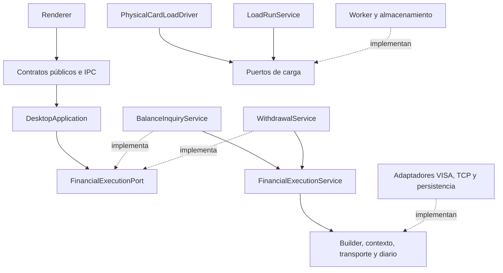

# ADR-032: Motor financiero compartido y contratos independientes

Fecha: 2026-11-02. Estado: implementado.

## Contexto

El usuario solicita mejorar la arquitectura. BalanceInquiryService concentraba
la ejecución de saldo y retiro, instanciaba builders VISA y era la superclase de
WithdrawalService. Los puertos dependían de tipos definidos en los codecs.
El driver de carga conocía clases concretas de aplicación, lector y sesión PIN;
los adaptadores de almacenamiento importaban contratos desde el servicio de carga.

## Decisión

- Extraer `FinancialExecutionService`: conserva la orquestación, idempotencia,
  persistencia previa al envío, cancelación, exclusión y limpieza de buffers.
  Recibe `FinancialMessageBuilder` como dependencia; no importa codecs ni framing.
- Mantener `BalanceInquiryService` y `WithdrawalService` como fachadas de
  composición independientes sobre el motor. Cada una fija su operación, builder
  y plazo predeterminado. Retiro deja de heredar del servicio de saldo.
- Ubicar los DTO de mensaje en `financial-message-contract.ts`. Sus campos
  conservan el alcance del perfil QA soportado; moverlos no generaliza ISO8583.
- Hacer que DesktopApplication consuma `FinancialExecutionPort`. Separar el
  contexto de ejecución y la validación del alcance de carga del servicio concreto.
- Publicar los contratos de carga en `load-ports.ts`: driver, fuente, scheduler,
  almacenamiento, operaciones financieras, lector y ciclo de vida de recursos.
  El driver solo controla inicio/cierre de PIN; su interfaz no expone el PIN.
- Proteger los límites con lint y pruebas que inspeccionan imports, tipos,
  reexports, require e imports dinámicos. Dominio permanece independiente;
  Renderer solo consume UI y contratos públicos.

## Dependencias implementadas

## Compatibilidad y validación

Se conservan contratos IPC, formatos persistidos, límites y clasificación de
resultados. La única selección de retiro mediante el sexto argumento de
BalanceInquiryService estaba en una prueba; ahora usa WithdrawalService como
la composición real. Las fachadas conservan los cinco argumentos usados por Main.
No hay dependencias nuevas, migración de datos ni nuevas reglas financieras.

La regresión incluye contratos de arquitectura, saldo/retiro, mensajería,
reversos, carga física sintética, TCP local y diarios. Los TODO-DATA transaccionales
existentes siguen vigentes. El motor aún implementa los dos flujos QA documentados;
no es un motor universal para cualquier procesador o escenario.

Validación local completada: 1010 pruebas unitarias, 263 de integración y cinco
E2E financieras/carga correctas. Lint, TypeScript strict, formato, build y chequeo
de secretos correctos. No se ejecutaron transacciones contra el host QA.
