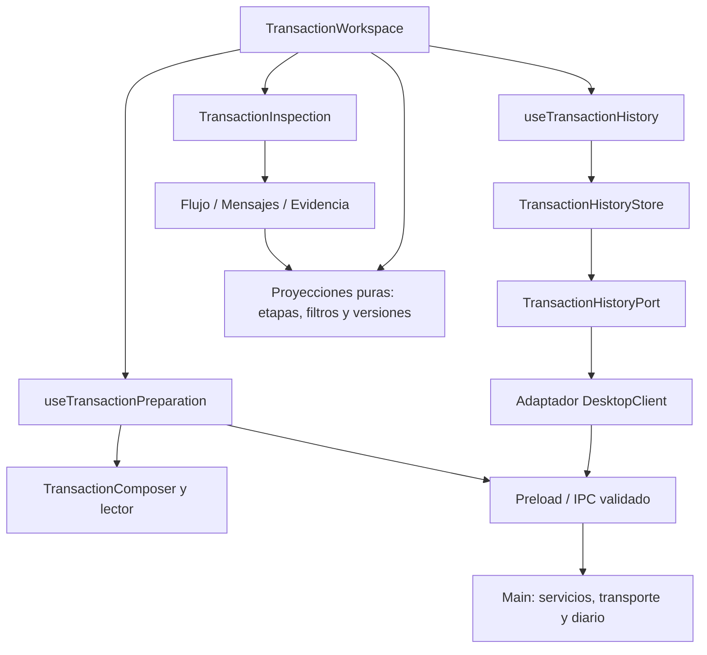

# ADR-033: Preparación e inspección independientes de transacciones

- Fecha: 2026-11-04
- Estado: Implementado
- Alcance: Renderer de Electron, contratos existentes de saldo/retiro QA.

## Problema

La pantalla concentraba preparación, envío, lector, historial y documentación
en un componente de unas 1.750 líneas. El flujo documental y los controles
RAW/HEX deshabilitados no permitían investigar una ejecución. Modificar el
borrador podía ocultar el resultado que el operador estaba revisando.

## Decisión

Separar preparación de inspección, con dependencias explícitas y sin nuevos
paquetes. La extracción estructural se realiza en un commit separado del cambio
de comportamiento.

- `useTransactionPreparation` conserva las decisiones de envío, recuperación,
  invalidación de tarjeta y protección del ambiente. El formulario presenta ese
  controlador; no implementa reglas ISO, TCP ni acceso a secretos.
- La selección de inspección referencia `requestId`. Editar el borrador no
  modifica el registro seleccionado. Iniciar una ejecución o una nueva
  transacción cambia su generación; cambiar ambiente invalida el contexto.
  Seleccionar historial nunca rellena ni ejecuta el formulario.
- El puerto de historial solo lee. El adaptador consulta los diarios existentes
  de saldo y retiro con el timeout de `DesktopClient`. El store publica snapshots
  y rechaza respuestas tardías por generación. Un fallo parcial conserva la
  última lista de esa fuente y la identifica como incompleta.
- Las funciones puras unen versiones por `requestId`, priorizan evidencia más
  reciente y evitan sustituir resultados finales por snapshots pendientes.
  Búsqueda, filtros y selección operan sobre los datos públicos ya proyectados.
- Flujo deriva las etapas de flags, mensajes y resultados registrados. Bytes
  entregados al transporte no prueban recepción del host. Una respuesta
  correlacionada no acredita débito ni dispensación. No se inventan tiempos por
  etapa ni nodos Core exitosos. Registro solo se verifica contra la versión
  recuperada del diario; un error de almacenamiento queda visible.
- Mensajes permite navegar por solicitud/respuesta y reverso, y abrir detalle
  de cada campo público. Mantiene las máscaras de ADR-030; no incorpora RAW/HEX.
- Evidencia usa la operación inspeccionada, aunque el borrador ya haya cambiado.
  Ofrece metadatos documentales y evidencia de captura disponible. El original
  CMS no está adjunto al visor: `TODO-DATA TRANSACTION-REFERENCE-SOURCES` limita
  únicamente esa apertura.

## Interacción y límites

Preparación puede ocultarse sin desmontar el lector ni perder la tarjeta.
Comprobante/reverso y detalles de tarjeta se despliegan cuando se necesitan.
El historial local consulta como máximo los últimos 50 registros por operación,
combinados con los 20 intentos de la sesión; no constituye una búsqueda completa
del diario. El observador remoto conserva su pantalla propia, denominada
**Observación** para distinguirlo del historial local.

No cambian contratos financieros, reglas de aprobación, seguridad del PIN,
conexiones, formato del diario ni habilitación de ambientes. Producción sigue
bloqueada. La duración de transporte sigue siendo la registrada por ejecución.

## Validación

- Unitarias: proyección de etapas, filtros, versiones, inmutabilidad, exclusión
  del Renderer de imports de Main/Node/Electron, lifecycle del store, respuestas
  tardías, errores parciales y dependencia que no responde.
- Integración: la evidencia visible se contrasta con envío/respuesta TCP de
  loopback y recuperación del diario SQLite; timeout y respuesta no
  correlacionada no completan la etapa de respuesta.
- Electron: selección sin envío ni cambio de borrador, lectura conservada al
  ocultar preparación, navegación por etapas/campos protegidos, documentación
  contextual, fallos parciales, cambio de ambiente y ventanas estrechas.

Las pruebas utilizan datos sintéticos; no validan comportamiento del host/Core.
