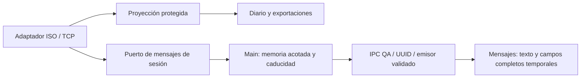

# ADR-037: Mensajes completos QA solo durante la sesión

Fecha: 2026-11-05. Estado: implementado por solicitud explícita del operador.

## Solicitud y excepción

El usuario solicita «hay campos que salen ofuscados por seguridad pero quiero
ver en claro todo». Esta instrucción autoriza mostrar los campos completos de
REQ/RESP en la estación QA y sustituye la máscara obligatoria de ADR-030 solo
para esta vista temporal. La revisión de seguridad distingue visualización de
persistencia: el diario, los logs, las exportaciones y el resto de pantallas
conservan sus protecciones. No se requieren ni exponen claves, PIN ingresado ni
secretos de configuración. Producción continúa bloqueada y PREPROD no accede.

## Decisión

- El adaptador decodifica todos los campos presentes mediante el perfil ISO
  existente, incluyendo PAN, vencimiento, Track 2, F48/F52/F53/F55/F60/F62/F63 y
  tags EMV. BCD conserva sus nibbles y ceros; EBCDIC usa el decodificador existente.
  Binarios y textos no soportados se representan íntegros en HEX. No se inventa
  semántica de subcampos privados ni se descifra el PIN Block o criptogramas.
- Un callback de diagnóstico entrega un DTO marcado `UNMASKED_QA_SESSION` a un
  puerto separado. Solo las respuestas correlacionadas 0210/0430 se capturan;
  fallos del diagnóstico no alteran envíos ni resultados. Capturar una solicitud
  preparada para transporte no prueba que se haya enviado.
- Main conserva hasta 20 solicitudes durante 15 minutos desde su captura inicial,
  con temporizador de retirada, sin archivos ni logs. Cambiar ambiente o cerrar
  la aplicación retira todas las entradas. La liberación de referencias JS no
  promete borrado físico de todas las copias administradas por el runtime.
- IPC dedicado valida UUID, claves exactas, ambiente solicitado y ambiente activo.
  Solo devuelve la entrada de esa solicitud, nunca una reconstrucción desde otro
  registro. El emisor sigue validado por el control IPC de Electron existente.
- Renderer solicita la entrada al abrir Mensajes y al cambiar el progreso. Descarta
  respuestas tardías, limpia la vista al salir/ocultar y retira valores al caducar.
  La opción **Mostrar todos los valores de esta sesión** está activada por defecto
  para cumplir la solicitud. Desactivarla restaura la proyección protegida.
- El DTO temporal no se añade a `BalanceExecution`. El diario solo recibe el DTO
  público y rechaza el marcador adicional y los valores fuera de su allowlist.
  Historiales anteriores y sesiones vencidas explican la ausencia del original;
  sus máscaras son irreversibles. Abrirlos no dispara operaciones financieras.

## Validación y límites

Pruebas sintéticas de decodificación, máscaras del diario, límites/caducidad,
validación IPC en aplicación, cambio de ambiente, TCP local con aprobación,
rechazo, timeout, respuesta ajena y los cuatro mensajes de retiro/reverso.
Electron comprueba valores completos, vuelta a máscaras, tabla/texto, retirada
al ocultar, expiración y error de consulta. No se ejecutan operaciones QA reales.
TODO-DATA ISO-PRIVATE-FIELD-DISPLAY sigue aplicando a interpretar subcampos
privados en el historial público, no a visualizar sus bytes HEX en esta sesión.
