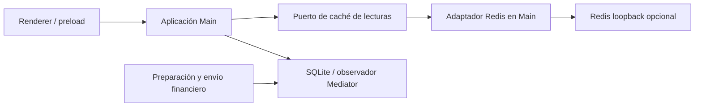

# ADR-045: Redis local opcional para consultas de presentación

Fecha: 2026-11-12. Fuente: solicitud del usuario de cachear datos consultados
frecuentemente y confirmación de Redis local opcional, con funcionamiento sin él.

## Decisión

Main usa un puerto de caché para el catálogo administrativo mostrado en UI
(30 segundos) y el feed público de Mediator (2 segundos). Son candidatos por
sus consumidores y polling existentes; no se afirma una medición de tráfico
que el proyecto no tiene. Redis escucha únicamente en loopback. Un fallo,
timeout o contenido inválido produce una lectura de la fuente original.

Los comandos del catálogo invalidan la caché antes y después de ejecutarse.
Cambiar de ambiente invalida las entradas de la sesión. Las consultas internas
de catálogo usadas para revisar perfiles, autorizar envíos o inspeccionar ATM
siguen consultando su fuente. El feed conserva la fecha de la lectura original.
No se cachean estados TCP/lector, preparaciones financieras, diarios, mensajes
ISO completos, PIN, claves ni datos de autenticación.

Las claves incluyen un UUID de sesión, revisión de invalidación y argumentos
validados. Las entradas caducan en Redis y se autentican con un secreto efímero
de Main para rechazar contenido alterado o intercambiado entre claves. La
caché no es una fuente de autorización ni se comparte entre estaciones.

## Dependencia y alternativas

Se incorpora `@redis/client` 6.3.1, cliente oficial de comandos básicos, detrás
del adaptador. Se evita el paquete agregado `redis` porque no se usan módulos
Search/JSON/Bloom. El riesgo es añadir otra conexión y un servicio local; se
mitiga con plazos cortos, cola offline deshabilitada, reconexión acotada por
consultas y cierre explícito. Implementar RESP propio añadiría mantenimiento
de protocolo; una caché exclusivamente en memoria no satisface la solicitud.

Fuentes del cliente: [configuración](https://github.com/redis/node-redis/blob/master/docs/client-configuration.md)
y [plazos de comandos](https://github.com/redis/node-redis/blob/master/docs/command-options.md).

## Validación

Pruebas de acierto, expiración, invalidación, datos alterados, error de origen,
Redis ausente/lento y consultas concurrentes. Integración con el cliente Redis
y TCP local, y con SQLite/Mediator sintético para verificar que las rutas
financieras y los controles de ambiente continúan usando sus fuentes.
