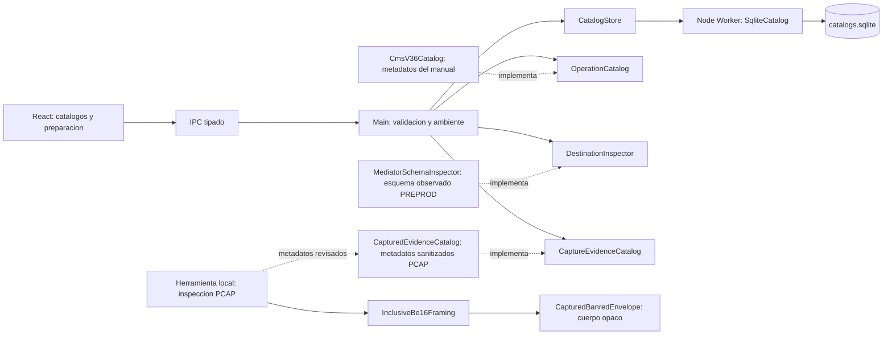

# Componentes

## Estado de implementacion inicial

Implementados: Desktop UI, preload IPC tipado, DesktopApplication en Main y
PreferencesStore como puerto con adaptador de archivo para ambiente y auditoria.
La segunda entrega agrega CatalogStore como puerto, adaptador WorkerCatalogStore y
SqliteCatalog en Worker. Main valida IPC y el ambiente activo; el Worker controla
integridad referencial, revisiones y transacciones de catalogo/auditoria.
La preparacion transaccional agrega OperationCatalog como puerto del dominio y
CmsV36Catalog como adaptador documental inyectado en Main. DraftRequest se valida
por IPC y se revalida contra preferencias/catalogos vigentes; no ejecuta tramas.
Renderer recibe los metadatos del catalogo y un DraftReview siempre BLOCKED.
DestinationInspector agrega comparacion de compatibilidad con evidencia guardada;
MediatorSchemaInspector implementa ese puerto en Main solo para PREPROD. No abre
conexion remota ni hereda la excepcion TLS de la inspeccion puntual.
CaptureEvidenceCatalog inyecta en Main los metadatos sanitizados del analisis
offline; el Renderer recibe conteos/fuentes, sin RAW ni endpoints. El codec
InclusiveBe16Framing (infraestructura) y CapturedBanredEnvelope (adaptador del
perfil observado) no acceden a Electron, sockets ni BD. La herramienta local
inspect-pcaps valida el pipeline y conserva payload solo en memoria.
El dominio cataloga escenarios/transacciones, valida contexto y sus requisitos
pendientes. La ejecución financiera está limitada a las rutas QA aprobadas de
saldo, retiro y reverso; no habilita producción ni generaliza reglas ISO.

Estado por componente:

| Componente        | Estado                                                                                          |
| ----------------- | ----------------------------------------------------------------------------------------------- |
| Desktop UI        | Implementado; IPC tipado y sin acceso directo a sockets, BD remotas ni secretos.                |
| CardReaderAdapter | Implementado para PC/SC y eventos de inserción/retiro; identidad EMV acotada.                   |
| Profile Manager   | Implementado: entidades, ATM y tarjetas por ambiente en SQLite.                                 |
| Transaction Engine| Implementado para saldo, retiro y reverso QA; no habilita producción.                           |
| ISO8583 Engine    | Parcial: codecs capturados, proyección ISO visible y mensajería del reverso (ADR-030).          |
| TCP Engine        | Implementado para el enlace QA con una conexión activa (ADR-029); framing y cierre ordenado.    |
| Load Engine       | Implementado con 1-5 operaciones, un solo transporte financiero y límites globales.             |
| Switch Observer   | Implementado como observador Mediator PREPROD de solo lectura y feed en vivo.                   |
| Core Adapter      | Parcial: adaptadores QA concretos; no hay adaptador Core genérico ni de producción.             |
| Realtime Agent    | No implementado; el Control Plane sigue propuesto en ADR-002.                                   |

Componentes aún planificados: Control Plane y agentes remotos, motor ISO genérico
para todos los perfiles, integración HSM y conexión a producción. Cualquier avance
en esos puntos requiere fuente aprobada y un ADR; ver `../TODO_DATA.md`.

Ver también `../implementation/BOOTSTRAP.md`, `../adr/ADR-003-DESKTOP-BOOTSTRAP.md`,
`../implementation/TRANSACTION_PREPARATION.md` y
`../adr/ADR-005-TRANSACTION-PREPARATION.md`.

## Desktop UI
Responsable de interaccion con QA. No accede directamente a sockets, BD remotas ni secretos.

## CardReaderAdapter
Abstraccion de PC/SC. Detecta lector, insercion/retiro y obtiene datos permitidos por la tarjeta.

## Profile Manager
Administra entidades, ATM y tarjetas.

## Transaction Engine
Orquesta una transaccion funcional y mantiene su state machine.

Estados sugeridos:
`CREATED -> BUILDING -> CONNECTING -> SENT -> WAITING -> RECEIVED -> VALIDATING -> CORRELATING -> COMPLETED/FAILED/TIMED_OUT/REVERSED`.

## ISO8583 Engine
Construccion, parsing, bitmap, codecs y validacion de campos.

## TCP Engine
Framing, conexiones persistentes, reconexion, timeout y correlacion socket/request.

## Load Engine
Generacion de concurrencia, rate limiting y workers.

## Switch Observer
Busca evidencia de la transaccion en SmartVista sin alterar datos.

## Core Adapter
Interfaz comun para consultar diferentes Cores.

## Realtime Agent
Heartbeats y streaming de metricas al Control Plane.
