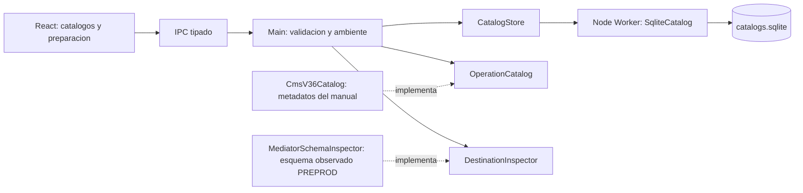

# Componentes

## Estado de implementacion inicial

Implementados: Desktop UI, preload IPC tipado, DesktopApplication en Main y
PreferencesStore como puerto con adaptador de archivo para ambiente y auditoria.
La segunda entrega agrega CatalogStore como puerto, adaptador WorkerCatalogStore y
SqliteCatalog en Worker. Main valida IPC y el ambiente activo; el Worker controla
integridad referencial, revisiones y transacciones de catalogo/auditoria.
La preparacion transaccional agrega OperationCatalog como puerto del dominio y
CmsV36Catalog como adaptador documental inyectado en Main. DraftRequest se valida
por IPC y se revalida contra preferencias/catalogos vigentes; no ejecuta tramas.
Renderer recibe los metadatos del catalogo y un DraftReview siempre BLOCKED.
DestinationInspector agrega comparacion de compatibilidad con evidencia guardada;
MediatorSchemaInspector implementa ese puerto en Main solo para PREPROD. No abre
conexion remota ni hereda la excepcion TLS de la inspeccion puntual.
El dominio cataloga escenarios/transacciones, valida contexto y sus requisitos
pendientes; no implementa el motor transaccional descrito mas abajo.

El resto de componentes sigue planificado. Ver `../implementation/BOOTSTRAP.md`
y `../adr/ADR-003-DESKTOP-BOOTSTRAP.md`.
Para preparacion documental: `../implementation/TRANSACTION_PREPARATION.md` y
`../adr/ADR-005-TRANSACTION-PREPARATION.md`.

## Desktop UI
Responsable de interaccion con QA. No accede directamente a sockets, BD remotas ni secretos.

## CardReaderAdapter
Abstraccion de PC/SC. Detecta lector, insercion/retiro y obtiene datos permitidos por la tarjeta.

## Profile Manager
Administra entidades, ATM y tarjetas.

## Transaction Engine
Orquesta una transaccion funcional y mantiene su state machine.

Estados sugeridos:
`CREATED -> BUILDING -> CONNECTING -> SENT -> WAITING -> RECEIVED -> VALIDATING -> CORRELATING -> COMPLETED/FAILED/TIMED_OUT/REVERSED`.

## ISO8583 Engine
Construccion, parsing, bitmap, codecs y validacion de campos.

## TCP Engine
Framing, conexiones persistentes, reconexion, timeout y correlacion socket/request.

## Load Engine
Generacion de concurrencia, rate limiting y workers.

## Switch Observer
Busca evidencia de la transaccion en SmartVista sin alterar datos.

## Core Adapter
Interfaz comun para consultar diferentes Cores.

## Realtime Agent
Heartbeats y streaming de metricas al Control Plane.
