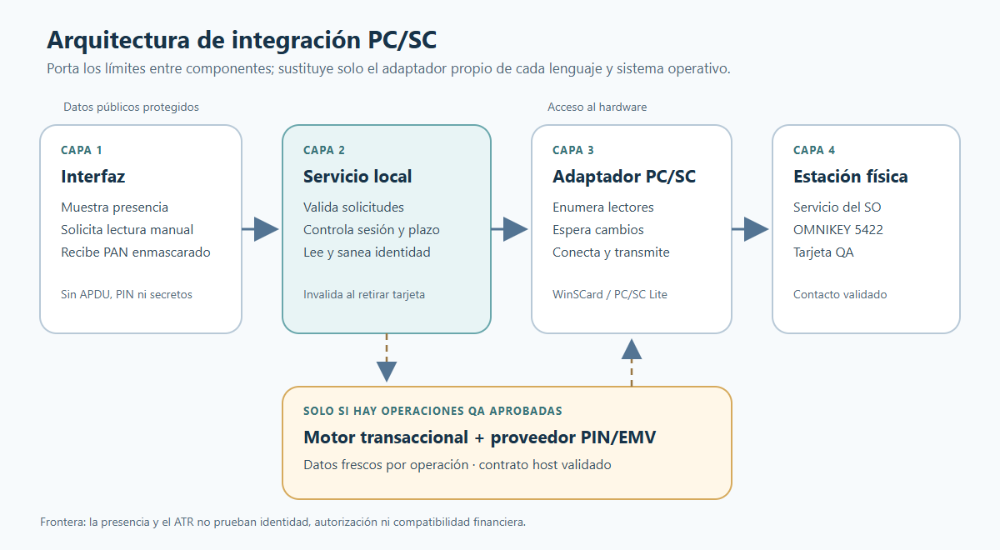
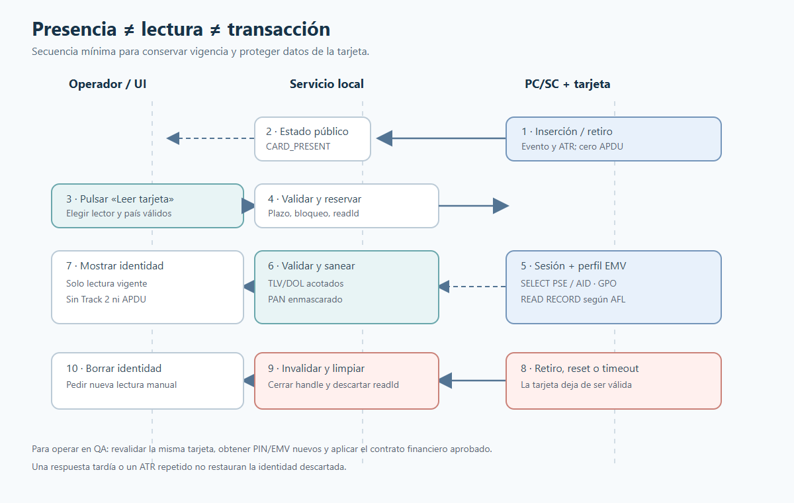

# Estándar de integración de lectores PC/SC para Python y C++

**Versión:** 1.0 · **Fecha:** 2026-10-22 · **Alcance:** estación local de QA

Esta guía permite trasladar a otro proyecto el diseño usado con el HID OMNIKEY
5422. Es un estándar de arquitectura e implementación, no un perfil universal de
tarjetas ni una autorización para enviar operaciones financieras. Los ejemplos
ejecutables al final solo enumeran lectores y consultan el ATR de una tarjeta
presente. No envían APDU ni leen PAN.

## 1. Decidir el alcance antes de programar

| Nivel | Resultado verificable | Dependencia adicional |
| --- | --- | --- |
| A. Presencia | Lectores, inserción/retiro, estado y ATR | PC/SC y hardware operativo |
| B. Identidad | Aplicación y campos EMV permitidos, PAN enmascarado | Perfil de tarjeta y reglas de lectura documentadas |
| C. Operación QA | Datos frescos del chip, PIN protegido y respuesta del host | Contrato EMV/PIN/HSM/ISO8583/host aprobado |

Una implementación de A no identifica una tarjeta. Una implementación de B no
autoriza pagos. C requiere decisiones y pruebas propias del proyecto destino.
La lectura por contacto del simulador actual se limita a tarjetas con PSE de
contacto y PDOL vacío o `9F1A` de dos bytes. No extrapolar ese perfil a
contactless, tarjetas sin PSE ni producción. Ver
[lectura EMV existente](EMV_IDENTITY_READING.md) y
[estado del lector](../implementation/CARD_READER_STATUS.md).

## 2. Arquitectura obligatoria



[Fuente SVG editable del diagrama](images/pcsc-portability-architecture.svg).

**Descripción de la imagen:** la interfaz solo recibe una proyección saneada;
un servicio local coordina estado y sesiones; el adaptador PC/SC accede al
lector. El módulo financiero, cuando existe, se conecta al servicio local y a
proveedores de seguridad aprobados, sin entregar comandos APDU o secretos a la
interfaz.

### Contratos independientes del lenguaje

```text
ReaderSnapshot {
  checkedAtUtc: ISO-8601,
  readers: [{ name, state: CARD_PRESENT | EMPTY | UNAVAILABLE, atr? }]
}

CardIdentity {
  readId: UUID,
  readAtUtc: ISO-8601,
  readerName,
  status: READ | SELECT_APPLICATION | DIRECTORY_UNAVAILABLE
          | TERMINAL_DATA_REQUIRED,
  applicationId?, applicationLabel?, panMasked?,
  cdol1Requirements?: [{ tag, length }],
  cdol2Requirements?: [{ tag, length }]
}

ReaderPort: list/observe/close
CardSessionPort: open/valid/begin/transmit/end/close
IdentityService: read(request)/current()/invalidate()
```

`CardSessionPort.transmit` es **interno** al servicio de hardware. No se publica
como API de UI, HTTP ni IPC genérica. `readId` identifica una lectura de la
sesión, no una tarjeta permanente. El ATR describe la interfaz/protocolo y no
es una clave única de identidad. Los nombres, estados y plazos son un contrato
propuesto para el nuevo proyecto; la secuencia EMV y el significado de datos
financieros se toman únicamente de sus fuentes aprobadas.

### Separación de procesos

- **Desktop:** ejecutar PC/SC fuera del hilo de UI; enviar a la UI solo estado
  e identidad protegida. Evitar que una lectura bloqueada congele la pantalla.
- **Web:** ejecutar PC/SC en un agente instalado en la estación que tiene el
  USB; el servidor remoto y el navegador reciben solo la API de alto nivel.
  Autenticar y limitar esa API según el entorno.
- **Servicio:** una sola autoridad coordina el uso del lector y cancela o
  serializa operaciones incompatibles. No dejar que dos solicitudes mezclen
  APDU de distintas tarjetas.

## 3. Flujo paso a paso



[Fuente SVG editable del diagrama](images/pcsc-portability-flow.svg).

1. **Preparar la estación.** Conectar el lector, confirmar que el sistema
   operativo lo expone a PC/SC y registrar SO, versión del controlador y nombre
   de cada interfaz. El simulador no instala controladores por sí mismo.
2. **Establecer contexto PC/SC.** En Windows, usar `SCardEstablishContext` y
   `SCardListReadersW`. En Linux, la implementación equivalente es PC/SC Lite.
   No seleccionar silenciosamente el primer lector si hay varios.
3. **Observar cambios.** Mantener un monitor de inserción, retiro y cambios de
   topología. `SCardGetStatusChangeW` permite esperar cambios sin consultar la
   UI periódicamente. `\\?PnP?\\Notification` identifica cambios de lectores
   en Windows. Cerrar o cancelar la espera durante el apagado.
4. **Leer solo bajo acción explícita.** Confirmar nombre del lector y estado
   `CARD_PRESENT`; conectar con `SCardConnect`, obtener el protocolo negociado
   y reservar temporalmente la tarjeta con `SCardBeginTransaction`.
5. **Aplicar el perfil EMV aprobado.** Seleccionar la aplicación anunciada por
   la tarjeta, procesar solo PDOL soportado y leer únicamente registros AFL.
   Rechazar TLV, longitudes, duplicados o respuestas inesperadas. Si faltan
   reglas para esa tarjeta, terminar con `TERMINAL_DATA_REQUIRED` o equivalente.
6. **Proyectar y comprobar vigencia.** Enmascarar PAN antes de salir del proceso
   local; nunca devolver Track 2 ni APDU brutas. Liberar el bloqueo, comprobar
   la sesión y asociar la proyección a un `readId` nuevo.
7. **Invalidar.** Retiro, reset, error, timeout, cambio de lector o cierre
   invalidan el `readId`, cancelan trabajo pendiente y limpian buffers privados.
   Una respuesta tardía no puede restaurar el estado anterior.
8. **Operar, si aplica.** Volver a seleccionar y comprobar la misma tarjeta bajo
   sesión exclusiva. Obtener seguridad EMV nueva para **esa** operación. El
   cifrado de PIN y los campos ISO siguen el contrato aprobado de QA. Liberar
   la sesión en `finally`/RAII y limpiar los datos sensibles.

Microsoft documenta la [observación de estados](https://learn.microsoft.com/en-us/windows/win32/api/winscard/nf-winscard-scardgetstatuschangew),
la [lista de lectores](https://learn.microsoft.com/en-us/windows/win32/api/winscard/nf-winscard-scardlistreadersw)
y el [acceso a tarjetas](https://learn.microsoft.com/en-us/windows/win32/secauthn/smart-card-and-reader-access-functions).
PC/SC Lite publica la [API para Linux](https://pcsclite.apdu.fr/api/group__API.html).
Para la capa EMV, consultar el [catálogo oficial de EMVCo](https://www.emvco.com/emv-technologies/emv-contact-chip/)
y el contrato de tarjetas aprobado por el proyecto destino.

## 4. Implementación de referencia: Python

### Base y responsabilidades

`pyscard` envuelve PC/SC en Windows, Linux y macOS. Su guía documenta
`smartcard.System.readers()`, `createConnection()`, `connect()`, `getATR()` y
`transmit()`; también ofrece `CardMonitor`. Ver la
[guía oficial de pyscard](https://pyscard.sourceforge.io/user-guide.html).
Fijar la versión de la dependencia en el proyecto destino y verificar su
compatibilidad con el SO y Python elegidos; esta guía no impone una versión.

El ejemplo [pcsc_probe.py](examples/python/pcsc_probe.py) implementa **nivel A
manual**: enumera lectores y, al pasar un nombre exacto, intenta conectar para
mostrar el ATR. No prueba vigilancia continua ni EMV. Uso:

```powershell
python -m pip install pyscard
python docs/hardware/examples/python/pcsc_probe.py
python docs/hardware/examples/python/pcsc_probe.py "NOMBRE EXACTO DEL LECTOR"
```

En una aplicación completa, envolver `pyscard` en clases propias:

```python
from typing import Callable, Protocol

# ReaderState y ReaderSnapshot son tipos del dominio del nuevo proyecto.
class ReaderPort(Protocol):
    def list_readers(self) -> list[ReaderState]: ...
    def observe(self, callback: Callable[[ReaderSnapshot], None]) -> Callable[[], None]: ...

class CardSession(Protocol):
    def valid(self) -> bool: ...
    def exchange(self, command: bytes) -> bytes: ...  # solo dentro del servicio
    def close(self) -> None: ...
```

El callback de presencia **no** llama a `transmit()`. La lectura manual usa un
`IdentityService` con bloqueo por lector, plazo máximo, contador de generación
y `try/finally` para liberar la sesión. Evitar observadores que registren APDU
o PAN; `pyscard` incluye herramientas de trazas que no deben activarse con
tarjetas reales sin una revisión específica.

### Diseño del parser EMV en Python

- Recibir únicamente `bytes` desde la sesión; no pasar APDU a la UI.
- Mantener el parser BER-TLV y DOL como funciones puras con límites explícitos
  de longitud, profundidad, registros y aplicaciones.
- Construir comandos desde una política de lectura aprobada y datos devueltos
  por la tarjeta; no probar AID conocidos ni completar PDOL desconocido con
  ceros por conveniencia.
- Convertir la respuesta a `CardIdentity` antes de cruzar la frontera de UI.
- Probar el parser con respuestas **sintéticas** y casos de rechazo; no guardar
  capturas con PAN real en fixtures.

Referencia de comportamiento acotado:
[emv-card-identity.ts](../../apps/desktop/src/main/adapters/emv-card-identity.ts).

## 5. Implementación de referencia: C++

### Base y responsabilidades

En Windows, incluir `winscard.h`, enlazar `Winscard.lib` y usar las variantes
Unicode (`...W`) de forma consistente. En Linux, usar los encabezados y el
enlace de PC/SC Lite. El ejemplo [pcsc_probe.cpp](examples/cpp/pcsc_probe.cpp)
es **Windows/C++17** y cubre nivel A manual: contexto RAII, enumeración,
selección exacta, conexión compartida, estado/ATR y liberación. No transmite
APDU. Compilar en una consola de MSVC configurada:

```powershell
cl /std:c++17 /EHsc /W4 docs\hardware\examples\cpp\pcsc_probe.cpp /link Winscard.lib
.\pcsc_probe.exe
.\pcsc_probe.exe "NOMBRE EXACTO DEL LECTOR"
```

Para el servicio completo, dividir interfaces y adaptadores:

```cpp
struct ReaderPort {
    virtual std::vector<ReaderState> list() = 0;
    virtual void observe(ReaderObserver&) = 0;
    virtual ~ReaderPort() = default;
};
struct CardSession {
    virtual bool valid() = 0;
    virtual Response exchange(std::span<const std::byte>) = 0;
    virtual ~CardSession() = default;
};
```

`std::span` requiere C++20; si el proyecto permanece en C++17, usar una vista
equivalente propia sin copiar buffers sensibles. Los handles `SCARDCONTEXT` y
`SCARDHANDLE` deben ser dueños únicos con destrucción RAII. Reservar la tarjeta
con `SCardBeginTransaction` solo durante la lectura/operación y cerrar con
`SCardEndTransaction` incluso ante excepción. Comprobar cada código de retorno;
no traducir cualquier fallo a «tarjeta ausente» ni mostrar errores brutos del
driver al usuario. Para detener una espera bloqueada, coordinar `SCardCancel`
con **el mismo contexto** de `SCardGetStatusChange`.

El parser EMV en C++ debe usar vistas de bytes con comprobación de límites y
copiar a memoria privada solo los campos necesarios. No serializar respuestas
APDU completas a archivos ni logs. Mantener estado de sesión y política de
tarjeta separados del adaptador Windows, para poder sustituir PC/SC o simularlo.

## 6. Reglas de seguridad y calidad

| Regla | Criterio verificable |
| --- | --- |
| Datos protegidos | UI y logs sin PAN completo, PIN, PIN Block, CVV, Track 2, APDU brutas ni criptogramas |
| Secretos | Fuera del repositorio; claves bajo el mecanismo aprobado del entorno |
| Acción manual | Presencia no inicia lectura APDU ni operación financiera |
| Sesión | Un lector/operación activa; cancelación, timeout y cierre liberan recursos |
| Vigencia | Retiro/reset invalida `readId`; ATR igual no confirma misma tarjeta |
| Entrada | Validar lector, AID, país, longitudes TLV/DOL y respuesta PC/SC |
| Fallos | Mensajes públicos acotados; causas técnicas sensibles no salen del agente |
| Entornos | QA/PREPROD separados; producción bloqueada hasta decisión formal |
| Datos de prueba | Fixtures sintéticos; evidencia real saneada y controlada |

La lógica de negocio, el transporte ISO/TCP y el acceso a secretos no deben
estar en el proceso de interfaz. Ver [AGENTS.md](../../AGENTS.md) y
[seguridad del proyecto](../security/SECURITY.md).

### Matriz mínima de pruebas para ambos lenguajes

| Caso | Esperado |
| --- | --- |
| Sin lector o sin servicio PC/SC | Error de dependencia, sin identidad anterior |
| Lector con tarjeta presente | Estado y ATR válidos; sin APDU automática |
| Inserción y retiro | Evento, limpieza de identidad y cancelación de sesión |
| Dos interfaces | Selección explícita; no inferir dos tarjetas distintas |
| Lectura válida del perfil aprobado | Identidad saneada; `readId` nuevo |
| PDOL/AID no soportado | Resultado bloqueado y dato requerido explícito |
| TLV, AFL, longitud o respuesta malformada | Rechazo sin datos parciales sensibles |
| Timeout, reset y respuesta tardía | Recursos liberados; lectura antigua no reaparece |
| Operación QA, si existe | PIN/EMV nuevos, correlación y resultado del host verificados |

Secuencia de verificación: unitarias con sesiones falsas → integración con
PC/SC simulado → aplicación local → hardware QA → host QA con autorización y
evidencia saneada. La última etapa nunca se deduce de que las anteriores pasen.

## 7. Datos que debe aportar el proyecto destino

Antes de construir el nivel B o C, registrar estos `TODO-DATA` y bloquear solo
la funcionalidad dependiente:

- **TODO-DATA PORT-PCSC-TARGET:** SO, modelo/interfaz de lector, controlador,
  versión, método de despliegue y contacto/contactless requeridos.
- **TODO-DATA PORT-CARD-EMV-PROFILE:** tarjetas QA permitidas, selección de AID,
  PDOL, registros y parámetros terminales aprobados; comportamiento cuando
  falte el directorio de contacto.
- **TODO-DATA PORT-TRANSACTION-SECURITY:** origen y custodia de PIN/llaves,
  proveedor EMV, reglas HSM y datos que deben ser frescos por operación.
- **TODO-DATA PORT-HOST-CONTRACT:** ISO8583, framing, endpoint, secuencias,
  timeout, correlación y códigos de respuesta aprobados por escenario.

La prioridad de fuentes es la de [AGENTS.md](../../AGENTS.md). Ante fuentes
contradictorias, registrar el conflicto y obtener validación; no elegir una
versión silenciosamente.

## 8. Correspondencia con la implementación existente

| Función | Código actual |
| --- | --- |
| Contrato de dominio | [`packages/domain/src/card-reader.ts`](../../packages/domain/src/card-reader.ts) |
| Monitor de eventos | [`windows-pcsc-monitor.ts`](../../apps/desktop/src/main/adapters/windows-pcsc-monitor.ts) y [`pcsc-monitor.ps1`](../../apps/desktop/src/main/adapters/pcsc-monitor.ps1) |
| Sesión PC/SC | [`windows-card-session.ts`](../../apps/desktop/src/main/adapters/windows-card-session.ts) y [`pcsc-card.ps1`](../../apps/desktop/src/main/adapters/pcsc-card.ps1) |
| Servicio de identidad | [`card-identity-service.ts`](../../apps/desktop/src/main/card-identity-service.ts) |
| Lector EMV acotado | [`emv-card-identity.ts`](../../apps/desktop/src/main/adapters/emv-card-identity.ts) |
| UI protegida | [`preload.ts`](../../apps/desktop/src/preload.ts) y [`CardReaderView.tsx`](../../apps/desktop/src/renderer/CardReaderView.tsx) |
| Operación QA acotada | [`qa-balance-execution-provider.ts`](../../apps/desktop/src/main/qa-balance-execution-provider.ts) |

El archivo `windows-pcsc-reader.ts` conserva una consulta puntual usada en
pruebas; el arranque actual usa `WindowsPcscMonitor` para eventos. Portar el
flujo vigente, no asumir que todo archivo histórico está activo.
